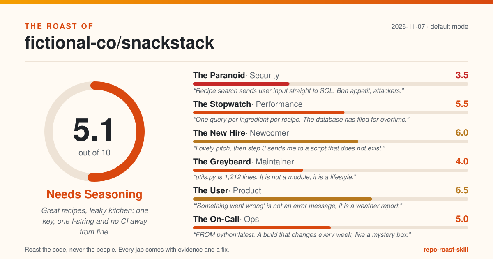
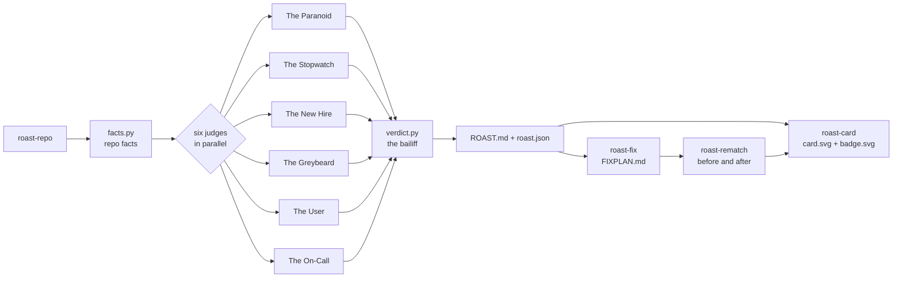

# repo-roast-skill

**Get your repo roasted by a panel of six brutally honest senior engineers. Every jab comes with evidence and a fix.**

[](LICENSE)
[](https://github.com/vivekbhange-hub/repo-roast-skill)



<sub>Example card for SnackStack, a made-up repo. Your card is generated from your own roast.</sub>

Code reviews are either too polite to be useful or too vague to act on. "Consider improving test coverage" changes nothing. "There is no CI, so the test suite runs whenever someone remembers, which is never" gets fixed the same afternoon, especially when it comes with the exact workflow file to add.

This Claude Code plugin puts your repository in front of six judges, each a subagent with its own personality and its own scoring rubric: **The Paranoid** (security), **The Stopwatch** (performance), **The New Hire** (first-day developer), **The Greybeard** (twenty-year maintainer), **The User** (product and UX) and **The On-Call** (ops and reliability). They read your code in parallel and come back with jokes, scores and fixes.

The catch, and the point: **no evidence, no roast**. Every jab must cite a real `file:line`, a command and its output, or a measured fact about the repo. A script checks every citation against your files and throws out anything that does not hold up, in public, at the bottom of the report. Every score is the sum of a five-part rubric. Tone goes from `--gentle` to `--savage`; the evidence bar never moves.

What you get: `roast/ROAST.md` with an overall score, each judge's roast, the top 10 fixes ranked by impact for the effort and the one thing to fix today, plus a 1200x630 SVG scorecard and a README badge you can post. Fix things, run a rematch, and the card shows before and after.

## What's inside

### Skills

| Skill | What it does |
|---|---|
| [`roast-repo`](skills/roast-repo/SKILL.md) | The main event. Gathers facts, runs the six judges in parallel, validates every citation, writes `roast/ROAST.md`, the card and the badge. |
| [`roast-card`](skills/roast-card/SKILL.md) | Renders the shareable 1200x630 SVG scorecard and a "roast score 7.4/10" badge, with before and after support. |
| [`roast-readme`](skills/roast-readme/SKILL.md) | Roasts only the README and the first five minutes a stranger spends with your project, then rewrites the top (saved only after you approve the diff). |
| [`roast-pr`](skills/roast-pr/SKILL.md) | Roasts a diff or pull request, citing new-side line numbers. Drafts polite review comments; posts nothing without a yes. |
| [`roast-fix`](skills/roast-fix/SKILL.md) | Turns the roast into `roast/FIXPLAN.md` and, on approval, fixes quick wins one at a time with your tests as the referee. Never commits. |
| [`roast-rematch`](skills/roast-rematch/SKILL.md) | Re-roasts after fixes and shows the score change per judge, dropped and new charges, and a before and after card. |

### Judges (agents, all read-only)

| Agent | Persona | Scores |
|---|---|---|
| [`judge-security`](agents/judge-security.md) | The Paranoid | secrets, injection and unsafe calls, dependencies, auth, safe defaults |
| [`judge-performance`](agents/judge-performance.md) | The Stopwatch | data access (N+1), hot-path algorithms, blocking IO and timeouts, payload size, resource use |
| [`judge-newcomer`](agents/judge-newcomer.md) | The New Hire | first impression, setup path, run and verify, naming, help on hand |
| [`judge-maintainer`](agents/judge-maintainer.md) | The Greybeard | tests, CI, structure, error handling, dead code and hygiene |
| [`judge-product`](agents/judge-product.md) | The User | problem clarity, promises kept, interface ergonomics, error messages, accessibility and polish |
| [`judge-ops`](agents/judge-ops.md) | The On-Call | configuration, logging, failure handling, build and deploy, release hygiene |

## Install

```
/plugin marketplace add vivekbhange-hub/repo-roast-skill
/plugin install repo-roast-skill@repo-roast-skill
```

Manual install: copy `skills/*` into `~/.claude/skills/` and `agents/*` into `~/.claude/agents/`.
The skills call each other's scripts by relative path, so copy all six skill folders together.

## Try it in 60 seconds

Open Claude Code in any repository and say:

```
roast my repo
```

or pick a tone:

```
/roast-repo --savage
```

Claude gathers the facts, the six judges read your code in parallel, and you get something like
this (an excerpt from [`examples/ROAST.example.md`](examples/ROAST.example.md), a roast of a
**fictional** repo; every file and line in it is made up):

```
# The Roast of fictional-co/snackstack

> Great recipes, leaky kitchen: one key, one f-string and no CI away from fine.

Overall: 5.1/10 (Needs Seasoning) · mode: default · 2026-11-07

## The one thing to fix today
Rotate the key at the provider today, load it from STRIPE_KEY in the environment,
add it to .env.example as a placeholder.

### The Greybeard (maintainer): 4.0/10
> utils.py is 1,212 lines. It is not a module, it is a lifestyle.
- No CI at all. The test suite runs whenever someone remembers, which is never.
  - Evidence: facts.ci.files
  - Fix: Add .github/workflows/test.yml running pytest on pull requests. (impact high, effort S)

## Thrown out by the bailiff
- The User: "Users probably hate the onboarding." (evidence must be path:line,
  '$ command -> output' or 'facts.<key>')
```

Files land in `roast/` in your repo: `ROAST.md`, `card.svg`, `badge.svg`, `roast.json` and the raw
panel verdicts. The badge looks like this: 

Other things to say: "roast my README", "roast PR 42", "fix the quick wins", "rematch".

## How it works



1. **Facts before opinions.** `facts.py` measures the repo: languages, largest files, test and CI
   presence, manifests and lockfiles, TODO/FIXME locations, git history stats (counts only, never
   names) and secret-looking strings (always redacted).
2. **The panel.** Six read-only subagents get the facts and read the code themselves. Each returns
   a fixed JSON verdict: a 0-10 score that is the sum of five 0-2 rubric criteria, a quotable
   one-liner, one piece of grudging praise and three to six roasts, each with line, evidence,
   fix, impact and effort.
3. **The bailiff.** `verdict.py` checks every `path:line` exists in your repo and is in range,
   every `facts.<key>` exists, and every roast has a fix. Failures are thrown out and listed.
   Scores that disagree with their rubric are corrected to the rubric.
4. **The ranking.** Fixes are ordered by impact divided by effort. The fix for today is the top
   small one, unless a live credential turns up, which always goes first.
5. **The card.** `card.py` renders the scorecard; `delta.py` adds before and after on a rematch.

All six helper scripts (`facts.py`, `verdict.py`, `card.py`, `badge.py`, `readme_lint.py`,
`delta.py`) are Python 3.9+, standard library only, no network, deterministic and unit-tested.

## Principles and limits

- **Roast the code, never the people.** Judges never name anyone from git history, never guess
  who wrote what, and never joke about identity. No profanity or slurs, even in `--savage`.
- **Every jab has evidence and a fix.** If it cannot be cited, it does not count.
- **Read-only by default.** Roasting changes nothing outside `roast/`. `roast-fix` and
  `roast-readme` edit code only after you approve; nothing is ever committed, pushed or posted.
- **It reads, it does not run.** Judges do not execute your project, install packages or touch the
  network, so the performance judge infers cost from code shape and says "likely" rather than
  inventing benchmarks. It will not find bugs that only show up at runtime.
- **It is an opinionated review, not an audit.** The security judge catches common mistakes; it is
  not a penetration test or a dependency vulnerability scanner. Use `npm audit`, `pip-audit` or
  your platform's scanner for CVEs.
- **Scores are comparable for the same repo over time**, which is what the rematch is for. Across
  different repos they are a conversation starter, not a ranking.
- Large monorepos get a focused roast of entry points and churn hotspots rather than every file.

## Contributing

Better jokes, sharper checks and bug reports are all welcome. See [CONTRIBUTING.md](CONTRIBUTING.md).

## License

MIT © 2026 Vivek Bhange. See [LICENSE](LICENSE).
