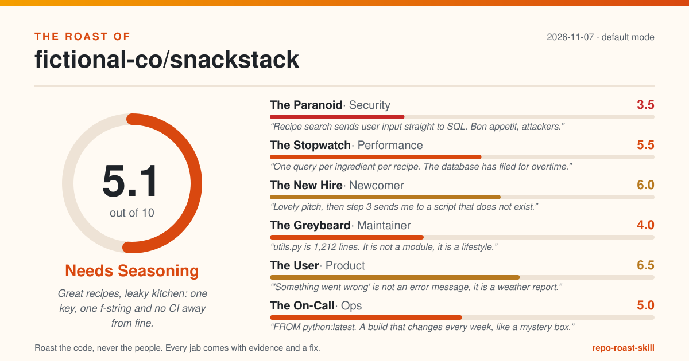

_Example output. SnackStack and fictional-co are made up: every file, line and score below is invented to show the format. Regenerate it with `python skills/roast-repo/verdict.py --judges examples/panel.example.json --repo-name fictional-co/snackstack --date 2026-11-07 --headline "..."`. Note the bailiff throwing out one jab with no evidence at the bottom._

# The Roast of fictional-co/snackstack

> Great recipes, leaky kitchen: one key, one f-string and no CI away from fine.

**Overall: 5.1/10 (Needs Seasoning)** · mode: default · 2026-11-07

| Judge | Score | Verdict |
|---|---|---|
| The Paranoid (security) | 3.5 | Recipe search sends user input straight to SQL. Bon appetit, attackers. |
| The Stopwatch (performance) | 5.5 | One query per ingredient per recipe. The database has filed for overtime. |
| The New Hire (newcomer) | 6.0 | Lovely pitch, then step 3 sends me to a script that does not exist. |
| The Greybeard (maintainer) | 4.0 | utils.py is 1,212 lines. It is not a module, it is a lifestyle. |
| The User (product) | 6.5 | 'Something went wrong' is not an error message, it is a weather report. |
| The On-Call (ops) | 5.0 | FROM python:latest. A build that changes every week, like a mystery box. |

## The one thing to fix today

**Rotate the key at the provider today, load it from STRIPE_KEY in the environment, add it to .env.example as a placeholder.**

Why: A live-looking Stripe key is committed in settings.py. It is not a secret if the whole internet has it. (The Paranoid, evidence: `snackstack/settings.py:12`)

## Top fixes, ordered by impact for the effort

| # | Fix | Evidence | Impact | Effort | Judge |
|---|---|---|---|---|---|
| 1 | Rotate the key at the provider today, load it from STRIPE_KEY in the environment, add it to .env.example as a placeholder. | `snackstack/settings.py:12` | high | S | The Paranoid |
| 2 | Use a parameterised query: cursor.execute("... WHERE title LIKE ?", (f"%{term}%",)). | `snackstack/search.py:41` | high | S | The Paranoid |
| 3 | Add a seed target to the Makefile that runs scripts/seed.py, or change the README to the command that exists. | `README.md:31` | high | S | The New Hire |
| 4 | Add .github/workflows/test.yml running pytest on pull requests. | `facts.ci.files` | high | S | The Greybeard |
| 5 | Read DEBUG from the environment and default it to False. | `snackstack/settings.py:4` | medium | S | The Paranoid |
| 6 | Add limit and cursor parameters with a default page size of 20. | `snackstack/api/recipes.py:72` | medium | S | The Stopwatch |
| 7 | Add .env.example listing DATABASE_URL and STRIPE_KEY, and fail with a message that names the missing variable. | `snackstack/db.py:9` | medium | S | The New Hire |
| 8 | Catch the specific parse error, log the recipe id and the reason, and count failures in the import summary. | `snackstack/importer.py:64` | medium | S | The Greybeard |
| 9 | Remove the claim until the export exists, or move it to a Roadmap section. | `README.md:12` | medium | S | The User |
| 10 | Pin python:3.12-slim, add a non-root user, and add a .dockerignore. | `Dockerfile:1` | medium | S | The On-Call |

## The panel

### The Paranoid (security): 3.5/10

> Recipe search sends user input straight to SQL. Bon appetit, attackers.

- **A live-looking Stripe key is committed in settings.py. It is not a secret if the whole internet has it.**
  - Evidence: `snackstack/settings.py:12`
  - Fix: Rotate the key at the provider today, load it from STRIPE_KEY in the environment, add it to .env.example as a placeholder. _(impact high, effort S)_
- **search() builds SQL with an f-string. Somewhere, a user named '; DROP TABLE recipes;-- is warming up.**
  - Evidence: `snackstack/search.py:41`
  - Fix: Use a parameterised query: cursor.execute("... WHERE title LIKE ?", (f"%{term}%",)). _(impact high, effort S)_
- **DEBUG = True ships to production, so every crash hands visitors a free tour of the stack trace.**
  - Evidence: `snackstack/settings.py:4`
  - Fix: Read DEBUG from the environment and default it to False. _(impact medium, effort S)_

Grudging praise: Passwords are hashed with bcrypt at a sensible cost factor (snackstack/auth.py:18).

Scorecard: Secrets hygiene 0, Injection & unsafe calls 0.5, Dependencies 1, Auth & access control 1, Safe defaults 1

### The Stopwatch (performance): 5.5/10

> One query per ingredient per recipe. The database has filed for overtime.

- **The recipe list fetches ingredients one recipe at a time: 50 recipes, 51 queries, one tired database.**
  - Evidence: `snackstack/api/recipes.py:88-95`
  - Fix: Fetch ingredients for all listed recipes in one query (WHERE recipe_id IN (...)) and group in memory. _(impact high, effort M)_
- **GET /recipes has no limit, so the homepage downloads the entire cookbook on every visit.**
  - Evidence: `snackstack/api/recipes.py:72`
  - Fix: Add limit and cursor parameters with a default page size of 20. _(impact medium, effort S)_

Grudging praise: Image thumbnails are generated once at upload and cached (snackstack/images.py:55).

Scorecard: Data access 0.5, Algorithms on hot paths 1, IO & concurrency 1.5, Payload & footprint 1, Resource use & caching 1.5

### The New Hire (newcomer): 6.0/10

> Lovely pitch, then step 3 sends me to a script that does not exist.

- **Step 3 says `make seed`. The Makefile has never heard of seed. Day one, hour one.**
  - Evidence: `README.md:31`
  - Fix: Add a seed target to the Makefile that runs scripts/seed.py, or change the README to the command that exists. _(impact high, effort S)_
- **The app needs DATABASE_URL, but the only place that says so is a KeyError.**
  - Evidence: `snackstack/db.py:9`
  - Fix: Add .env.example listing DATABASE_URL and STRIPE_KEY, and fail with a message that names the missing variable. _(impact medium, effort S)_

Grudging praise: The first paragraph says exactly who it is for and what it does (README.md:3).

Scorecard: First impression 1.5, Setup path 0.5, Run & verify 1, Naming & navigation 1.5, Help on hand 1.5

### The Greybeard (maintainer): 4.0/10

> utils.py is 1,212 lines. It is not a module, it is a lifestyle.

- **No CI at all. The test suite runs whenever someone remembers, which is never.**
  - Evidence: `facts.ci.files`
  - Fix: Add .github/workflows/test.yml running pytest on pull requests. _(impact high, effort S)_
- **`except Exception: pass` in the importer. Whatever went wrong, it has taken it to the grave.**
  - Evidence: `snackstack/importer.py:64`
  - Fix: Catch the specific parse error, log the recipe id and the reason, and count failures in the import summary. _(impact medium, effort S)_
- **utils.py holds dates, money, slugs, emails and a hand-rolled CSV parser. Everything is a util if you believe hard enough.**
  - Evidence: `snackstack/utils.py:1-1212`
  - Fix: Split by topic into dates.py, money.py, text.py; replace the CSV parser with the csv module. _(impact medium, effort L)_

Grudging praise: Commit history is readable; the last 50 messages say what changed.

Scorecard: Tests 0.5, CI & automation 0, Structure 1, Error handling 1, Hygiene 1.5

### The User (product): 6.5/10

> 'Something went wrong' is not an error message, it is a weather report.

- **The README promises 'export your cookbook as PDF'. The code promises nothing of the sort.**
  - Evidence: `README.md:12`
  - Fix: Remove the claim until the export exists, or move it to a Roadmap section. _(impact medium, effort S)_
- **Every API failure returns {"error": "Something went wrong"}, including a typo in the recipe id.**
  - Evidence: `snackstack/api/errors.py:22`
  - Fix: Return a specific message and code per case: 404 'recipe 812 not found', 422 with the invalid field. _(impact medium, effort M)_

Grudging praise: The API returns consistent JSON shapes with clear field names (snackstack/api/schemas.py:1).

Scorecard: Problem clarity 2, Promises kept 1, Interface ergonomics 1.5, Error messages 0.5, Accessibility & polish 1.5

### The On-Call (ops): 5.0/10

> FROM python:latest. A build that changes every week, like a mystery box.

- **The Dockerfile pins nothing and runs as root, so every rebuild is a surprise with admin rights.**
  - Evidence: `Dockerfile:1`
  - Fix: Pin python:3.12-slim, add a non-root user, and add a .dockerignore. _(impact medium, effort S)_
- **The nutrition API call has no timeout. It will wait forever, which is longer than my shift.**
  - Evidence: `snackstack/nutrition.py:30`
  - Fix: Pass timeout=5 to requests.get and return a cached value or a clear 503 when it expires. _(impact medium, effort S)_

Grudging praise: There is a CHANGELOG and it is actually up to date (CHANGELOG.md:1).

Scorecard: Configuration 0.5, Logging & observability 1, Failure handling 1, Build & deploy 1, Release hygiene 1.5

## Thrown out by the bailiff

These jabs had no admissible evidence, so they do not count:

- The User: "Users probably hate the onboarding." (evidence must be path:line, '$ command -> output' or 'facts.<key>')

## How this was scored

Each judge scores five criteria from 0 to 2 (total 0-10). The overall score is the plain average of the judges. A roast only counts if it cites a real `file:line`, a command and its output, or a fact from `facts.json`, and comes with a fix. Fixes are ranked by impact divided by effort. Tone mode changes the jokes, never the evidence bar.

Admitted roasts: 14 · thrown out: 1
