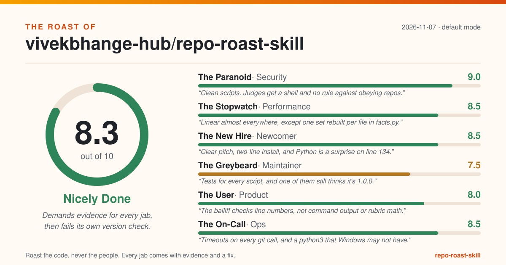
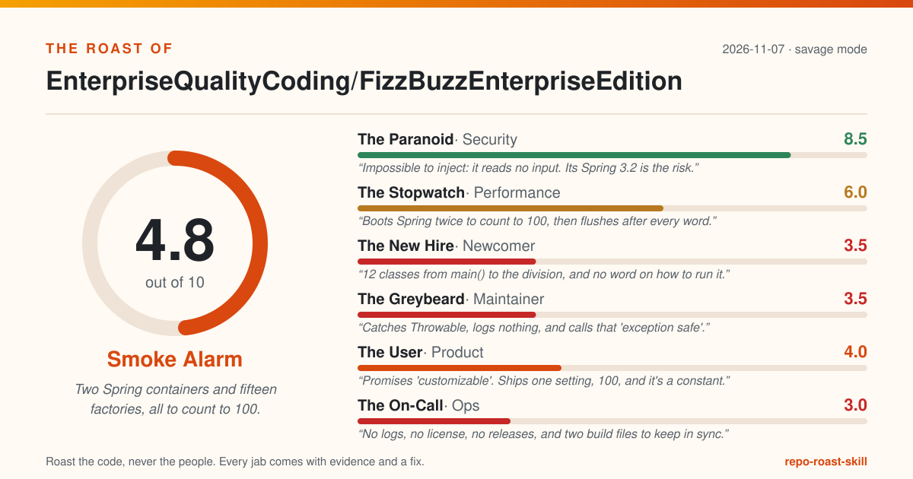
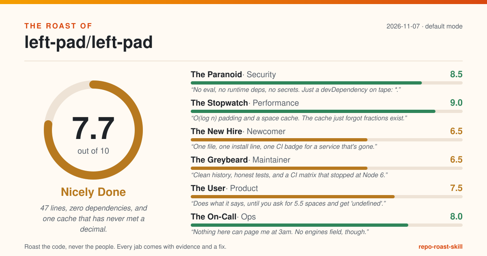

# Real roasts

Unedited output from running `roast-repo` on real public repositories. Every `file:line` in these
reports passed the bailiff (`verdict.py`) against the exact commit listed below, so you can open
the repo at that commit and check each one.

| Repo | Commit roasted | Mode | Score | Report |
|---|---|---|---|---|
| [vivekbhange-hub/repo-roast-skill](https://github.com/vivekbhange-hub/repo-roast-skill) (this repo) | `784f59b` (v1.0.1) | default | 8.3 | [ROAST.md](self-roast/ROAST.md) |
| [EnterpriseQualityCoding/FizzBuzzEnterpriseEdition](https://github.com/EnterpriseQualityCoding/FizzBuzzEnterpriseEdition) | `4922c07` | savage | 4.8 | [ROAST.md](fizzbuzz/ROAST.md) |
| [left-pad/left-pad](https://github.com/left-pad/left-pad) | `2fca615` | default | 7.7 | [ROAST.md](left-pad/ROAST.md) |

## The self-roast

The tool's first real victim was itself. Its top finding was correct: v1.0.1 bumped the version
without updating a test that hard-coded `1.0.0`, so CI was red. It also found that a rubric like
`{"Vibes": 10}` would score 10/10, that the README promised a credential-first rule the code did
not implement, and that the judges had no rule against obeying instructions planted in the repo
they read. Those were fixed in [v1.1.0](../../CHANGELOG.md); the smaller findings are open as
[good first issues](https://github.com/vivekbhange-hub/repo-roast-skill/issues).

## FizzBuzzEnterpriseEdition

A satire repo that over-engineers FizzBuzz on purpose, judged with a straight face in savage
mode. It would not even `git clone` on Windows until long paths were enabled: one file path is
173 characters.

## left-pad

The headline bug, `leftPad('foo', 5.5)` returning `'undefinedfoo'`, comes from the space cache
at `index.js:29` being indexed with a fractional length. Roasting left-pad also exposed two bugs
in this tool's fact gatherer (it missed a root-level `test.js`, and did not know Travis runs
`npm test` by default), both fixed in v1.0.1.

## How these were made

Claude Code followed `skills/roast-repo/SKILL.md` on a local clone of each repo: `facts.py`, then
the six judges using the rubrics in `agents/`, then `verdict.py`, `card.py` and `badge.py`. A
few judge verdict one-liners were shortened afterwards so they fit on the card without being cut;
scores, rubrics, evidence and fixes are as the judges wrote them. The judges only read the code;
none of these repos was built or run. Criticism is of the code at that commit, never of the
people who wrote it.
