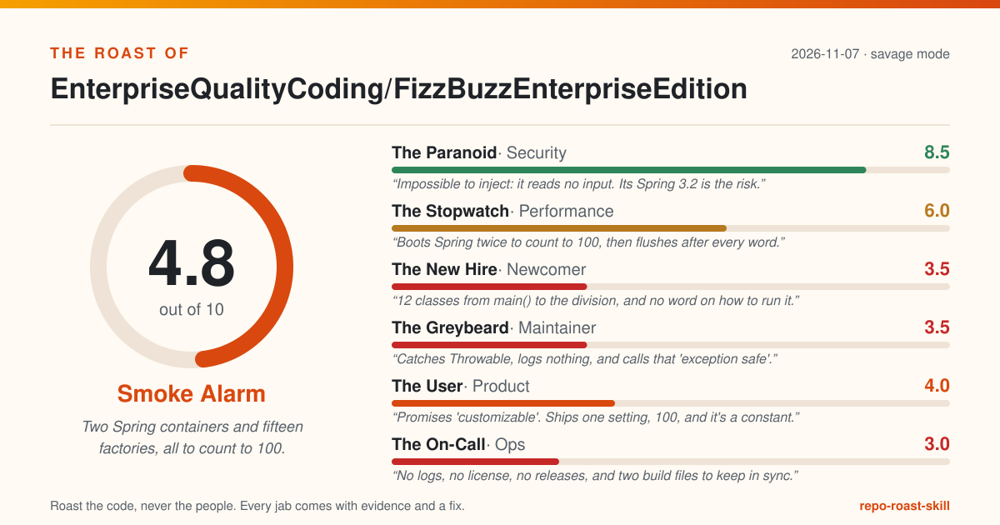

# The Roast of EnterpriseQualityCoding/FizzBuzzEnterpriseEdition

> Two Spring containers and fifteen factories, all to count to 100.

**Overall: 4.8/10 (Smoke Alarm)** · mode: savage · 2026-11-07

| Judge | Score | Verdict |
|---|---|---|
| The Paranoid (security) | 8.5 | Impossible to inject: it reads no input. Its Spring 3.2 is the risk. |
| The Stopwatch (performance) | 6.0 | Boots Spring twice to count to 100, then flushes after every word. |
| The New Hire (newcomer) | 3.5 | 12 classes from main() to the division, and no word on how to run it. |
| The Greybeard (maintainer) | 3.5 | Catches Throwable, logs nothing, and calls that 'exception safe'. |
| The User (product) | 4.0 | Promises 'customizable'. Ships one setting, 100, and it's a constant. |
| The On-Call (ops) | 3.0 | No logs, no license, no releases, and two build files to keep in sync. |

## The one thing to fix today

**Inject LoopComponentFactory into EnterpriseGradeFizzBuzzSolutionStrategy, pass it to LoopContext's constructor, and delete the ClassPathXmlApplicationContext on LoopContext.java:28.**

Why: Every runSolution call builds a LoopContext, and every LoopContext boots a brand-new Spring container that component-scans the whole app to fetch one factory, then closes it again. Main already had a container open. This is likely the most expensive line in the program. (The Stopwatch, evidence: `src/main/java/com/seriouscompany/business/java/fizzbuzz/packagenamingpackage/impl/loop/LoopContext.java:28-35`)

## Top fixes, ordered by impact for the effort

| # | Fix | Evidence | Impact | Effort | Judge |
|---|---|---|---|---|---|
| 1 | Inject LoopComponentFactory into EnterpriseGradeFizzBuzzSolutionStrategy, pass it to LoopContext's constructor, and delete the ClassPathXmlApplicationContext on LoopContext.java:28. | `src/main/java/com/seriouscompany/business/java/fizzbuzz/packagenamingpackage/impl/loop/LoopContext.java:28-35` | high | S | The Stopwatch |
| 2 | Add a README note to run `git config --global core.longpaths true` before cloning on Windows; then shorten the package root (`com.seriouscompany.business.java.fizzbuzz.packagenamingpackage`) and the adapter names. | `src/main/java/com/seriouscompany/business/java/fizzbuzz/packagenamingpackage/impl/strategies/adapters/FizzBuzzOutputStrategyToFizzBuzzExceptionSafeOutputStrategyAdapter.java:9` | high | S | The New Hire |
| 3 | Add a 'Build and run' section after README.md:27: the JDK it needs (the code targets 1.7, pom.xml:63-64), `./gradlew run`, `./gradlew test`, and the expected first lines of output. | `README.md:22-34` | high | S | The New Hire |
| 4 | Delete both catch blocks and let failures reach Main, or catch IOException only, report it with the value being written, and rethrow. | `src/main/java/com/seriouscompany/business/java/fizzbuzz/packagenamingpackage/impl/strategies/adapters/FizzBuzzOutputStrategyToFizzBuzzExceptionSafeOutputStrategyAdapter.java:26-31` | high | S | The Greybeard |
| 5 | Parse args[0] in Main and pass it to the existing, never-called DefaultFizzBuzzUpperLimitParameter(int) constructor (DefaultFizzBuzzUpperLimitParameter.java:24), falling back to 100, and print a usage line for bad input. | `src/main/java/com/seriouscompany/business/java/fizzbuzz/packagenamingpackage/impl/Main.java:19-23` | high | S | The User |
| 6 | Never catch Throwable; catch IOException at most and let Errors end the process. | `src/main/java/com/seriouscompany/business/java/fizzbuzz/packagenamingpackage/impl/strategies/adapters/FizzBuzzOutputStrategyToFizzBuzzExceptionSafeOutputStrategyAdapter.java:30-31` | high | S | The On-Call |
| 7 | Delete the pip step; when CI moves to GitHub Actions, upload coverage with the codecov action pinned to a commit SHA. | `.travis.yml:2` | medium | S | The Paranoid |
| 8 | Same fix as LoopContext.java:28; once the container is injected, the test boots exactly one. | `src/test/java/FizzBuzzTest.java:66-84` | medium | S | The Stopwatch |
| 9 | Add an 'Architecture' paragraph to the README listing the call chain from Main to IntegerDivider, or collapse the chain (see the maintainer's fixes). | `src/main/java/com/seriouscompany/business/java/fizzbuzz/packagenamingpackage/impl/math/arithmetics/IntegerDivider.java:47` | medium | S | The New Hire |
| 10 | Delete impl/printers/IntegerPrinter.java so the name points at exactly one type. | `src/main/java/com/seriouscompany/business/java/fizzbuzz/packagenamingpackage/impl/printers/IntegerPrinter.java:12` | medium | S | The New Hire |

## The panel

### The Paranoid (security): 8.5/10

> Impossible to inject: it reads no input. Its Spring 3.2 is the risk.

- **Five Spring modules pinned at 3.2.13.RELEASE, a release line that reached end of life years ago. The FizzBuzz rules are timeless; the framework under them is not.**
  - Evidence: `build.gradle:20-24`
  - Fix: Move to a supported Spring release in build.gradle and pom.xml together (or drop Spring entirely), then audit with OWASP dependency-check (`mvn org.owasp:dependency-check-maven:check`). _(impact medium, effort M)_
- **CI opens every build with `sudo pip install codecov`: an unpinned package, installed as root, fetched fresh on every run.**
  - Evidence: `.travis.yml:2`
  - Fix: Delete the pip step; when CI moves to GitHub Actions, upload coverage with the codecov action pinned to a commit SHA. _(impact medium, effort S)_
- **The Gradle wrapper downloads Gradle with no distributionSha256Sum, so the build tool itself arrives on trust.**
  - Evidence: `gradle/wrapper/gradle-wrapper.properties:6`
  - Fix: Add `distributionSha256Sum=<checksum published on gradle.org>` below distributionUrl, and commit gradle/verification-metadata.xml for dependency verification. _(impact low, effort S)_
- **No lockfile and no dependency verification, so an 'enterprise-grade' build resolves whatever the repository serves that day.**
  - Evidence: `facts.dependencies.has_lockfile`
  - Fix: Enable Gradle dependency locking (`dependencyLocking { lockAllConfigurations() }`) and commit the generated gradle.lockfile. _(impact low, effort S)_

Grudging praise: Zero attack surface: src/main/java/com/seriouscompany/business/java/fizzbuzz/packagenamingpackage/impl/Main.java:19-23 ignores args and reads no env, files or network; the only output is System.out, so hostile input has nowhere to go.

Scorecard: Secrets hygiene 2, Injection & unsafe calls 2, Dependencies 0.5, Auth & access control (n/a) 2, Safe defaults 2

### The Stopwatch (performance): 6.0/10

> Boots Spring twice to count to 100, then flushes after every word.

- **Every runSolution call builds a LoopContext, and every LoopContext boots a brand-new Spring container that component-scans the whole app to fetch one factory, then closes it again. Main already had a container open. This is likely the most expensive line in the program.**
  - Evidence: `src/main/java/com/seriouscompany/business/java/fizzbuzz/packagenamingpackage/impl/loop/LoopContext.java:28-35`
  - Fix: Inject LoopComponentFactory into EnterpriseGradeFizzBuzzSolutionStrategy, pass it to LoopContext's constructor, and delete the ClassPathXmlApplicationContext on LoopContext.java:28. _(impact high, effort S)_
- **The test pays for that 17 times: setUp boots one container, then each of the 16 doFizzBuzz calls boots another inside LoopContext.**
  - Evidence: `src/test/java/FizzBuzzTest.java:66-84`
  - Fix: Same fix as LoopContext.java:28; once the container is injected, the test boots exactly one. _(impact medium, effort S)_
- **Checking whether 9 is a multiple of 3 means IntegerDivider converting both ints to doubles, dividing, choosing floor or ceil by sign, and converting back. The % operator has been in Java since 1.0.**
  - Evidence: `src/main/java/com/seriouscompany/business/java/fizzbuzz/packagenamingpackage/impl/math/arithmetics/IntegerDivider.java:45-56`
  - Fix: In NumberIsMultipleOfAnotherNumberVerifier, return `nSecondNumber != 0 && nFirstNumber % nSecondNumber == 0`; IntegerDivider and both double comparators can then be deleted. _(impact low, effort S)_
- **NoFizzNoBuzzStrategy's else-if branch only runs when the number is a multiple of 3, then asks again whether it is not a multiple of 3. It can only return false, after one or two divisions it never needed.**
  - Evidence: `src/main/java/com/seriouscompany/business/java/fizzbuzz/packagenamingpackage/impl/strategies/NoFizzNoBuzzStrategy.java:28-35`
  - Fix: Replace the whole method body with `return !isMultiple(theInteger, 3) && !isMultiple(theInteger, 5);`. _(impact low, effort S)_
- **The output strategy flushes after every token, so 100 numbers cost over 200 flushes (each value, each newline) where one would do.**
  - Evidence: `src/main/java/com/seriouscompany/business/java/fizzbuzz/packagenamingpackage/impl/strategies/SystemOutFizzBuzzOutputStrategy.java:22-23`
  - Fix: Write through one BufferedWriter created with the output strategy and flush once after LoopRunner.runLoop finishes. _(impact low, effort S)_
- **To return the constant "Fizz", FizzStringReturner builds a StringBuilder, calls toString, copies it into a char array, then copies that into a new String. Three copies of four letters.**
  - Evidence: `src/main/java/com/seriouscompany/business/java/fizzbuzz/packagenamingpackage/impl/stringreturners/FizzStringReturner.java:17-21`
  - Fix: `return Constants.FIZZ;` (and the same one-liner in BuzzStringReturner and NewLineStringReturner). _(impact low, effort S)_

Grudging praise: The loop itself is linear: src/main/java/com/seriouscompany/business/java/fizzbuzz/packagenamingpackage/impl/loop/LoopRunner.java:33-35 visits each number once, and the three output contexts are built once in the constructor (SingleStepOutputGenerationStrategy.java:49-59), not per number.

Scorecard: Data access (n/a) 2, Algorithms on hot paths 1.5, IO & concurrency 1, Payload & footprint 1, Resource use & caching 0.5

### The New Hire (newcomer): 3.5/10

> 12 classes from main() to the division, and no word on how to run it.

- **Day one ended at git clone: on Windows it failed with 'Filename too long' until core.longpaths was enabled, because this adapter's path is 173 characters before you even pick a folder.**
  - Evidence: `src/main/java/com/seriouscompany/business/java/fizzbuzz/packagenamingpackage/impl/strategies/adapters/FizzBuzzOutputStrategyToFizzBuzzExceptionSafeOutputStrategyAdapter.java:9`
  - Fix: Add a README note to run `git config --global core.longpaths true` before cloning on Windows; then shorten the package root (`com.seriouscompany.business.java.fizzbuzz.packagenamingpackage`) and the adapter names. _(impact high, effort S)_
- **The README explains enterprise software and the rules of FizzBuzz, then ends. Not one line on how to build it, run it, test it, or which of the two build files (pom.xml, build.gradle) is the real one.**
  - Evidence: `README.md:22-34`
  - Fix: Add a 'Build and run' section after README.md:27: the JDK it needs (the code targets 1.7, pom.xml:63-64), `./gradlew run`, `./gradlew test`, and the expected first lines of output. _(impact high, effort S)_
- **I opened 12 classes, from Main to the line that finally divides by 3: StandardFizzBuzz, a factory, a strategy, LoopContext, LoopRunner, a payload, another strategy, a visitor, FizzStrategy, a verifier, and at last IntegerDivider.**
  - Evidence: `src/main/java/com/seriouscompany/business/java/fizzbuzz/packagenamingpackage/impl/math/arithmetics/IntegerDivider.java:47`
  - Fix: Add an 'Architecture' paragraph to the README listing the call chain from Main to IntegerDivider, or collapse the chain (see the maintainer's fixes). _(impact medium, effort S)_
- **There are two types called IntegerPrinter: the interface the code actually uses, and an impl class with a constructor, one field and no methods that nothing references.**
  - Evidence: `src/main/java/com/seriouscompany/business/java/fizzbuzz/packagenamingpackage/impl/printers/IntegerPrinter.java:12`
  - Fix: Delete impl/printers/IntegerPrinter.java so the name points at exactly one type. _(impact medium, effort S)_
- **CONTRIBUTING.md is a code of conduct and nothing else: no build steps, no test command, no style rules.**
  - Evidence: `CONTRIBUTING.md:1`
  - Fix: Rename it CODE_OF_CONDUCT.md and write a short CONTRIBUTING.md with the build, test and pull request steps. _(impact low, effort S)_

Grudging praise: README.md:22-27 states the FizzBuzz rules plainly, and src/test/java/TestConstants.java:10 spells out the exact expected output for 1 to 16, so 'correct' is written down.

Scorecard: First impression 1.5, Setup path 0.5, Run & verify 0.5, Naming & navigation 0.5, Help on hand 0.5

### The Greybeard (maintainer): 3.5/10

> Catches Throwable, logs nothing, and calls that 'exception safe'.

- **The 'ExceptionSafe' adapter catches Exception, then Throwable, and does nothing with either. The comment says 'We're the enterprise...we don't get exceptions!' Correct: they are all thrown away.**
  - Evidence: `src/main/java/com/seriouscompany/business/java/fizzbuzz/packagenamingpackage/impl/strategies/adapters/FizzBuzzOutputStrategyToFizzBuzzExceptionSafeOutputStrategyAdapter.java:26-31`
  - Fix: Delete both catch blocks and let failures reach Main, or catch IOException only, report it with the value being written, and rethrow. _(impact high, effort S)_
- **IntegerDivider builds an ArithmeticException with a proper message, and the verifier catches it and returns false, so 'divide by zero' is reported as 'not a multiple'.**
  - Evidence: `src/main/java/com/seriouscompany/business/java/fizzbuzz/packagenamingpackage/impl/math/arithmetics/NumberIsMultipleOfAnotherNumberVerifier.java:50-51`
  - Fix: Remove the try/catch; reject a zero divisor once at the boundary with an IllegalArgumentException that names the value. _(impact medium, effort S)_
- **The divider lives in a static field assigned from an instance @PostConstruct hook. LoopContext's second container re-runs that hook and repoints the static at its own divider, then LoopContext closes that container seven lines after opening it.**
  - Evidence: `src/main/java/com/seriouscompany/business/java/fizzbuzz/packagenamingpackage/impl/math/arithmetics/NumberIsMultipleOfAnotherNumberVerifier.java:18-30`
  - Fix: Make integerDivider an injected instance field and numberIsMultipleOfAnotherNumber an instance method; then delete ApplicationContextHolder, whose only caller is this class. _(impact high, effort M)_
- **There are 15 factories and the keyword `new` appears in exactly one of them. Every other create method returns the singleton Spring injected, so 'create' means 'return'.**
  - Evidence: `$ git grep -n "new " -- src/main/java/com/seriouscompany/business/java/fizzbuzz/packagenamingpackage/impl/factories -> 1 match: LoopComponentFactory.java:56`
  - Fix: Inject the strategies and printers directly where they are used and delete the pass-through factories, starting with the ones that only wrap a single bean. _(impact medium, effort L)_
- **FizzPrinter, BuzzPrinter, NewLinePrinter and impl.printers.IntegerPrinter are Spring beans with a constructor, one unused field and no methods. Nothing references them, yet BuzzPrinter is one of the most-changed files in the repo.**
  - Evidence: `src/main/java/com/seriouscompany/business/java/fizzbuzz/packagenamingpackage/impl/printers/BuzzPrinter.java:12-25`
  - Fix: Delete the four classes; the *StringPrinter and IntegerIntegerPrinter classes already do the printing. _(impact low, effort S)_
- **CI builds on oraclejdk7 and openjdk7 and nothing newer, with no lint step, and the README badge still points at travis-ci.org.**
  - Evidence: `.travis.yml:5-7`
  - Fix: Move CI to a GitHub Actions workflow that runs `./gradlew check` on a current LTS JDK for every pull request, with Checkstyle or SpotBugs, and update the badge in README.md:3-6. _(impact medium, effort M)_

Grudging praise: The one test checks real output, not just that nothing threw: src/test/java/FizzBuzzTest.java:49-58 captures System.out and asserts the exact text for 1 to 16, with platform line endings handled on line 57.

Scorecard: Tests 1, CI & automation 0.5, Structure 1, Error handling 0, Hygiene 1

### The User (product): 4.0/10

> Promises 'customizable'. Ships one setting, 100, and it's a constant.

- **The README sells 'particularly customizable and extensible solutions'. main() ignores its arguments and always builds the default parameter, so the limit is 100 unless you recompile. No --help, no usage line, no flags.**
  - Evidence: `src/main/java/com/seriouscompany/business/java/fizzbuzz/packagenamingpackage/impl/Main.java:19-23`
  - Fix: Parse args[0] in Main and pass it to the existing, never-called DefaultFizzBuzzUpperLimitParameter(int) constructor (DefaultFizzBuzzUpperLimitParameter.java:24), falling back to 100, and print a usage line for bad input. _(impact high, effort S)_
- **If writing output fails, the adapter swallows it, so the user gets no message and the process still exits 0.**
  - Evidence: `src/main/java/com/seriouscompany/business/java/fizzbuzz/packagenamingpackage/impl/strategies/adapters/FizzBuzzOutputStrategyToFizzBuzzExceptionSafeOutputStrategyAdapter.java:26-31`
  - Fix: Let output errors reach Main, print one line to System.err naming what failed, and exit with status 1. _(impact medium, effort S)_
- **Call print() on IntegerIntegerPrinter and the error message is the method's own fully qualified name, held in a constant whose name is 106 characters long. That is a return address, not an explanation.**
  - Evidence: `src/main/java/com/seriouscompany/business/java/fizzbuzz/packagenamingpackage/impl/printers/IntegerIntegerPrinter.java:52-54`
  - Fix: Throw `new UnsupportedOperationException("IntegerIntegerPrinter only prints integers; call printValue(Integer)")` and delete the constant at Constants.java:10. _(impact low, effort S)_
- **The only other human-readable error, 'The integers could not be compared.', sits in a branch that runs only if two ints are neither equal, less nor greater.**
  - Evidence: `src/main/java/com/seriouscompany/business/java/fizzbuzz/packagenamingpackage/impl/strategies/comparators/integercomparator/ThreeWayIntegerComparator.java:27-29`
  - Fix: Delete the unreachable else branch and make the third case a plain else. _(impact low, effort S)_

Grudging praise: It does the job it describes: the rules in README.md:22-27 are exactly what the test asserts for 1 to 16 (src/test/java/TestConstants.java:10), FizzBuzz at 15 included.

Scorecard: Problem clarity 1.5, Promises kept 1, Interface ergonomics 0.5, Error messages 0.5, Accessibility & polish (CLI) 0.5

### The On-Call (ops): 3.0/10

> No logs, no license, no releases, and two build files to keep in sync.

- **`catch (Throwable)` also swallows OutOfMemoryError and StackOverflowError, so a JVM in real trouble keeps printing numbers as if nothing happened.**
  - Evidence: `src/main/java/com/seriouscompany/business/java/fizzbuzz/packagenamingpackage/impl/strategies/adapters/FizzBuzzOutputStrategyToFizzBuzzExceptionSafeOutputStrategyAdapter.java:30-31`
  - Fix: Never catch Throwable; catch IOException at most and let Errors end the process. _(impact high, effort S)_
- **Not one logger, log call or System.err line in 89 source files. When something fails, the incident report is a blank page.**
  - Evidence: `$ git grep -n -i -E "logger|slf4j|log4j|java.util.logging|System.err" -- src -> no matches`
  - Fix: Add SLF4J with a simple binding and log failures in Main with the number being processed. _(impact medium, effort S)_
- **The Gradle wrapper pins Gradle 2.8, from 2015, which predates Java 9; the build uses compile/testCompile, which Gradle 7 removed, and resolves from jcenter(), which has been sunset.**
  - Evidence: `gradle/wrapper/gradle-wrapper.properties:6`
  - Fix: Upgrade the wrapper to a current Gradle, replace jcenter() with mavenCentral() (build.gradle:5), switch compile/testCompile to implementation/testImplementation (build.gradle:20,26), and set a current Java release. _(impact high, effort M)_
- **Two build systems for one app: build.gradle and pom.xml each declare the same five Spring jars, so every upgrade has to land twice or the builds quietly diverge.**
  - Evidence: `build.gradle:19-26`
  - Fix: Keep Gradle (it has the application run task, build.gradle:2 and 29), move the jacoco setup from pom.xml:79-97 into it, and delete pom.xml. _(impact medium, effort M)_
- **Version 1.0-SNAPSHOT, no git tags and no CHANGELOG: there has never been a release, only a snapshot that stopped changing.**
  - Evidence: `pom.xml:7`
  - Fix: Tag a 1.0.0, add a CHANGELOG.md, and let CI attach the built jar to a GitHub release. _(impact low, effort S)_
- **No LICENSE file, so for all its enterprise ambitions nobody has actually been granted permission to reuse it.**
  - Evidence: `facts.docs.license`
  - Fix: Add a LICENSE file (MIT or Apache-2.0) at the repo root. _(impact medium, effort S)_

Grudging praise: Every dependency is pinned to an exact version (build.gradle:20-26, pom.xml:18-48), not a range, so the jars at least do not drift between builds.

Scorecard: Configuration 1, Logging & observability 0.5, Failure handling 0.5, Build & deploy 0.5, Release hygiene 0.5

## How this was scored

Each judge scores five criteria from 0 to 2 (total 0-10). The overall score is the plain average of the judges. A roast only counts if it cites a real `file:line`, a command and its output, or a fact from `facts.json`, and comes with a fix. Fixes are ranked by impact divided by effort. Tone mode changes the jokes, never the evidence bar.

Admitted roasts: 31 · thrown out: 0
