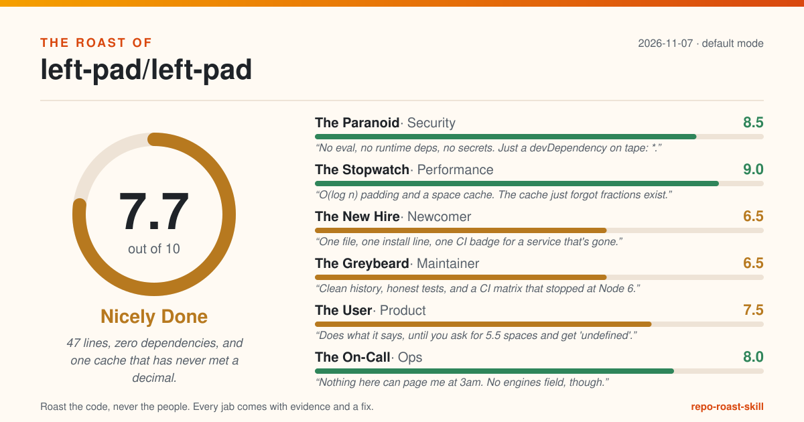

# The Roast of left-pad/left-pad

> 47 lines, zero dependencies, and one cache that has never met a decimal.

**Overall: 7.7/10 (Nicely Done)** · mode: default · 2026-11-07

| Judge | Score | Verdict |
|---|---|---|
| The Paranoid (security) | 8.5 | No eval, no runtime deps, no secrets. Just a devDependency on tape: *. |
| The Stopwatch (performance) | 9.0 | O(log n) padding and a space cache. The cache just forgot fractions exist. |
| The New Hire (newcomer) | 6.5 | One file, one install line, one CI badge for a service that's gone. |
| The Greybeard (maintainer) | 6.5 | Clean history, honest tests, and a CI matrix that stopped at Node 6. |
| The User (product) | 7.5 | Does what it says, until you ask for 5.5 spaces and get 'undefined'. |
| The On-Call (ops) | 8.0 | Nothing here can page me at 3am. No engines field, though. |

## The one thing to fix today

**In index.js:29, guard the lookup: read `var hit = cache[len]` and return `hit + str` only when `ch === ' ' && hit !== undefined`. Otherwise fall through to the loop. Add a fractional-len case to test.js, because the property tests only generate integers (test.js:51 uses fc.nat).**

Why: The speed-up cache trusts any `len` under 10 to be an array index. Ask for `leftPad('foo', 5.5)` and, reading the code, len becomes 2.5, `cache[2.5]` is undefined, and you get 'undefinedfoo'. Fast, and wrong. (The Stopwatch, evidence: `index.js:29`)

## Top fixes, ordered by impact for the effort

| # | Fix | Evidence | Impact | Effort | Judge |
|---|---|---|---|---|---|
| 1 | In index.js:29, guard the lookup: read `var hit = cache[len]` and return `hit + str` only when `ch === ' ' && hit !== undefined`. Otherwise fall through to the loop. Add a fractional-len case to test.js, because the property tests only generate integers (test.js:51 uses fc.nat). | `index.js:29` | medium | S | The Stopwatch |
| 2 | Replace .travis.yml with a GitHub Actions workflow that runs `npm test` on the current Node LTS releases. | `.travis.yml:2-6` | medium | S | The Greybeard |
| 3 | Add one status line at README.md:3: stable and feature-complete, and for new code prefer the built-in String.prototype.padStart where its single-character behaviour fits. | `facts.git.last_commit` | medium | S | The Greybeard |
| 4 | Truncate the pad length before using it (e.g. `len = Math.floor(len - str.length)` at index.js:21), or guard the fast path with `cache[len] !== undefined`. Add a fractional-length case to test.js, since the property tests at test.js:51 only generate whole numbers via fc.nat. | `index.js:29` | medium | S | The User |
| 5 | Pick one behaviour and ship it: either slice the finished pad to the requested length at index.js:46, or throw a TypeError naming the argument ('leftPad: ch must be a single character, got "ab"'). Then narrow the comment in index.d.ts:3 to match. | `README.md:31` | medium | S | The User |
| 6 | Pin it to a range you have tested, e.g. `"tape": "^5.7.0"`, and let a dependency bot propose upgrades. | `package.json:14` | low | S | The Paranoid |
| 7 | Commit package-lock.json. It never ships to users of the package, but it makes `npm test` reproducible for contributors and CI. | `facts.dependencies.has_lockfile` | low | S | The Paranoid |
| 8 | Add a short SECURITY.md that names a private contact or enables GitHub private vulnerability reporting. | `facts.docs.security_policy` | low | S | The Paranoid |
| 9 | At module load in index.js, check `typeof ''.repeat === 'function'` and use `ch.repeat(len) + str` when it exists, keeping the loop at index.js:31-44 as the fallback. This keeps today's output, including multi-char `ch`. Do not switch to padStart, which truncates multi-char fills. Run `npm run bench` before claiming it is faster. | `perf/es6Repeat.js:12` | low | S | The Stopwatch |
| 10 | Add `"files": ["index.js", "index.d.ts"]` to package.json so the tarball holds only the runtime file and its types (npm adds README, LICENSE and package.json on its own). | `package.json:1-36` | low | S | The Stopwatch |

## The panel

### The Paranoid (security): 8.5/10

> No eval, no runtime deps, no secrets. Just a devDependency on tape: *.

- **`"tape": "*"` means every fresh dev install trusts whatever tape version was published last, including one that has never been reviewed here.**
  - Evidence: `package.json:14`
  - Fix: Pin it to a range you have tested, e.g. `"tape": "^5.7.0"`, and let a dependency bot propose upgrades. _(impact low, effort S)_
- **No lockfile, so two contributors running `npm install` a month apart are testing against different dependency trees and neither knows it.**
  - Evidence: `facts.dependencies.has_lockfile`
  - Fix: Commit package-lock.json. It never ships to users of the package, but it makes `npm test` reproducible for contributors and CI. _(impact low, effort S)_
- **No security policy, so someone who finds a problem has to guess whether to open a public issue about it.**
  - Evidence: `facts.docs.security_policy`
  - Fix: Add a short SECURITY.md that names a private contact or enables GitHub private vulnerability reporting. _(impact low, effort S)_

Grudging praise: Zero runtime dependencies (package.json:11-15 holds devDependencies only) and no dynamic code anywhere in index.js, so installing this pulls in exactly one function and nothing it could be tricked into running.

Scorecard: Secrets hygiene 2, Injection & unsafe calls 2, Dependencies 1, Auth & access control 2, Safe defaults 1.5

### The Stopwatch (performance): 9.0/10

> O(log n) padding and a space cache. The cache just forgot fractions exist.

- **The speed-up cache trusts any `len` under 10 to be an array index. Ask for `leftPad('foo', 5.5)` and, reading the code, len becomes 2.5, `cache[2.5]` is undefined, and you get 'undefinedfoo'. Fast, and wrong.**
  - Evidence: `index.js:29`
  - Fix: In index.js:29, guard the lookup: read `var hit = cache[len]` and return `hit + str` only when `ch === ' ' && hit !== undefined`. Otherwise fall through to the loop. Add a fractional-len case to test.js, because the property tests only generate integers (test.js:51 uses fc.nat). _(impact medium, effort S)_
- **perf/ keeps String.prototype.repeat in the benchmark lineup and index.js still ships the hand-rolled loop. The loop makes sense for the Node 0.12 in the Travis matrix, but newer engines never get the built-in path.**
  - Evidence: `perf/es6Repeat.js:12`
  - Fix: At module load in index.js, check `typeof ''.repeat === 'function'` and use `ch.repeat(len) + str` when it exists, keeping the loop at index.js:31-44 as the fallback. This keeps today's output, including multi-char `ch`. Do not switch to padStart, which truncates multi-char fills. Run `npm run bench` before claiming it is faster. _(impact low, effort S)_
- **Your users install a 47-line function, and because nothing limits the publish, the test suite and three benchmark files most likely ship with it.**
  - Evidence: `package.json:1-36`
  - Fix: Add `"files": ["index.js", "index.d.ts"]` to package.json so the tarball holds only the runtime file and its types (npm adds README, LICENSE and package.json on its own). _(impact low, effort S)_
- **All six benchmark suites pad with spaces, so they never measure the doubling loop with any other character. The README's own zero-padding examples always skip the cache and go through that loop.**
  - Evidence: `perf/perf.js:35-40`
  - Fix: Add suites in perf/perf.js that pad with '0' and '*' at lengths 9, 10 and 100, matching README.md:24-28. Delete the unused `str` and `len` variables at perf/perf.js:8-9. _(impact low, effort S)_

Grudging praise: index.js:33-44 pads by doubling `ch` and appending on odd bits, so building the pad takes about log2(len) concatenations instead of len. It also ships with zero runtime dependencies (package.json:11-15 lists devDependencies only).

Scorecard: Data access (n/a) 2, Algorithms on hot paths 2, IO & concurrency (n/a) 2, Payload & footprint 1.5, Resource use & caching 1.5

### The New Hire (newcomer): 6.5/10

> One file, one install line, one CI badge for a service that's gone.

- **The first thing under the title is a build badge from travis-ci.org, which shut down in 2021. Day one, and the status light is already broken.**
  - Evidence: `README.md:35`
  - Fix: Move CI to GitHub Actions and swap the badge for the Actions workflow badge, or remove it until CI runs again. _(impact low, effort S)_
- **package.json defines `test` and `bench` scripts, and the README mentions neither. I found out how to run the tests by reading JSON.**
  - Evidence: `package.json:8-9`
  - Fix: Add a short Development section to the README: `npm install`, `npm test`, `npm run bench`, and what passing output looks like. _(impact low, effort S)_
- **A benchmark file is literally named `O(n).js`. Typing `node perf/O(n).js` in bash gets you a syntax error before any benchmark runs.**
  - Evidence: `perf/perf.js:2`
  - Fix: Rename it to perf/linear.js and update the require at perf/perf.js:2. _(impact low, effort S)_
- **No CONTRIBUTING file, so how to propose a change is tribal knowledge spread over 72 commits.**
  - Evidence: `facts.docs.contributing`
  - Fix: Add a CONTRIBUTING.md with three lines: run `npm test`, add a test for any behaviour change, keep the module dependency-free. _(impact low, effort S)_

Grudging praise: The entry point is impossible to miss: package.json:5 points at index.js, and the whole implementation fits on one screen with a comment on almost every line (index.js:18-45).

Scorecard: First impression 1.5, Setup path 2, Run & verify 1, Naming & navigation 1.5, Help on hand 0.5

### The Greybeard (maintainer): 6.5/10

> Clean history, honest tests, and a CI matrix that stopped at Node 6.

- **The CI matrix tests Node 0.12, 4, 5 and 6, all end-of-life for years. Every Node version people actually run today is untested.**
  - Evidence: `.travis.yml:2-6`
  - Fix: Replace .travis.yml with a GitHub Actions workflow that runs `npm test` on the current Node LTS releases. _(impact medium, effort S)_
- **The property tests run on fast-check 0.0.8, pinned exactly. That is a pre-1.0 release of a library now several major versions on.**
  - Evidence: `package.json:13`
  - Fix: Upgrade fast-check, update runProperty at test.js:50-58 to the current `fc.assert(fc.property(...))` API, and add `fc.double` lengths so the fractional case gets generated. _(impact low, effort M)_
- **Last commit 2019-03-15, none in the last 90 days, and the README never says whether that means 'finished' or 'abandoned'.**
  - Evidence: `facts.git.last_commit`
  - Fix: Add one status line at README.md:3: stable and feature-complete, and for new code prefer the built-in String.prototype.padStart where its single-character behaviour fits. _(impact medium, effort S)_

Grudging praise: Real tests with real assertions, including property-based checks (test.js:60-83), and not one lazy commit message in the last 72 (facts.git.lazy_commit_messages.count).

Scorecard: Tests 1.5, CI & automation 0.5, Structure 2, Error handling 1, Hygiene 1.5

### The User (product): 7.5/10

> Does what it says, until you ask for 5.5 spaces and get 'undefined'.

- **Ask for a width of 5.5 with the default space and you get 'undefinedfoo'. The cache lookup lets fractional lengths straight through, and index.d.ts:3 says any number is fine.**
  - Evidence: `index.js:29`
  - Fix: Truncate the pad length before using it (e.g. `len = Math.floor(len - str.length)` at index.js:21), or guard the fast path with `cache[len] !== undefined`. Add a fractional-length case to test.js, since the property tests at test.js:51 only generate whole numbers via fc.nat. _(impact medium, effort S)_
- **The README says the pad character 'should be a single char' and then shrugs. Pass 'ab' with a target of 5 and you get 7 characters back, because index.js:41 doubles the whole string.**
  - Evidence: `README.md:31`
  - Fix: Pick one behaviour and ship it: either slice the finished pad to the requested length at index.js:46, or throw a TypeError naming the argument ('leftPad: ch must be a single character, got "ab"'). Then narrow the comment in index.d.ts:3 to match. _(impact medium, effort S)_
- **Bad input never gets an error message. It gets a confident wrong answer, and the user has to work out what happened.**
  - Evidence: `index.js:17-47`
  - Fix: Validate `len` (finite, non-negative) and `ch` (length 1 after coercion) at the top of leftPad, and throw messages that name the argument and the value received. If silent coercion is deliberate, say so in the README. _(impact low, effort S)_
- **'String left pad' is the whole pitch, and the README never writes out the signature. You learn that `len` is the total width, not the amount of padding, by reading the examples.**
  - Evidence: `README.md:3`
  - Fix: Under Usage, add one line such as `leftPad(str, len, ch = ' ')` that says `len` is the final total length and that shorter or equal lengths return `str` unchanged. _(impact low, effort S)_
- **Both caveats stop at 'see issue #N'. The README sends you off-site to learn what an emoji does to your column width.**
  - Evidence: `README.md:33`
  - Fix: Spell the consequence out inline, e.g. 'Characters outside the Basic Multilingual Plane, such as most emoji, count as 2 toward len, so the padded output will look one column short.' Keep the link as a footnote. _(impact low, effort S)_
- **This is version 1.3.0 with no changelog, so anyone upgrading has to guess what changed.**
  - Evidence: `facts.docs.changelog`
  - Fix: Add a CHANGELOG.md with one entry per published version (package.json:3 is at 1.3.0), noting any behaviour changes to defaults or coercion. _(impact low, effort S)_

Grudging praise: The four usage examples at README.md:15-29 all match what the code does, including the zero pad character, which index.js:25 deliberately treats as a real value and not as 'no character given'.

Scorecard: Problem clarity 1.5, Promises kept 2, Interface ergonomics 1.5, Error messages 1, Accessibility & polish 1.5

### The On-Call (ops): 8.0/10

> Nothing here can page me at 3am. No engines field, though.

- **package.json still points at stevemao/left-pad over SSH. Anyone without a GitHub SSH key who follows it from npm gets a permission error instead of the code.**
  - Evidence: `package.json:24-27`
  - Fix: Set `"repository": {"type": "git", "url": "git+https://github.com/left-pad/left-pad.git"}`. _(impact low, effort S)_
- **No engines field, so npm can't tell anyone which Node versions this was tested on. The only answer is a Travis file that stops at Node 6.**
  - Evidence: `.travis.yml:2-6`
  - Fix: Add `"engines": {"node": ">=0.12"}` (or whatever the new CI matrix proves) to package.json. _(impact low, effort S)_
- **Builds aren't reproducible: no lockfile and an unpinned tape mean the CI result depends on the day you ran it.**
  - Evidence: `package.json:11-15`
  - Fix: Commit package-lock.json and run `npm ci` in CI instead of `npm install`. _(impact low, effort S)_

Grudging praise: Releases are tagged (v1.1.1 through v1.3.0 in git tags), and a pure function with no IO, config or logging has almost nothing that can fail in production.

Scorecard: Configuration 2, Logging & observability 2, Failure handling 1.5, Build & deploy 1, Release hygiene 1.5

## How this was scored

Each judge scores five criteria from 0 to 2 (total 0-10). The overall score is the plain average of the judges. A roast only counts if it cites a real `file:line`, a command and its output, or a fact from `facts.json`, and comes with a fix. Fixes are ranked by impact divided by effort. Tone mode changes the jokes, never the evidence bar.

Admitted roasts: 23 · thrown out: 0
